# 🛡️ Enterprise Legal & Enterprise Document Redactor
### *AI-Powered Multi-Agent PII Anonymization Platform with In-Place Document Structure Preservation*

[](https://www.python.org/)
[](https://www.djangoproject.com/)
[-09a3d5.svg)](https://spacy.io/)
[](https://aistudio.google.com/)
[](LICENSE)

---

## 📌 1. Executive Summary

In enterprise, legal, HR, healthcare, and financial domains, sharing sensitive documents without leaking **Personally Identifiable Information (PII)** is mandatory under regulations such as GDPR, HIPAA, and the Digital Personal Data Protection (DPDP) Act.

Traditional automated redactors suffer from **two catastrophic flaws**:
1. **Formatting & Structure Destruction:** Legacy conversion pipelines extract text as plain strings and re-save them as blank, generic documents—destroying corporate fonts, table borders, cell structures, column widths, headers, footers, and visual branding.
2. **Context Blindness & High False Positives:** Simple rule-based or single-model systems either hallucinate (e.g., treating *"Apple"* as a corporation when describing a fruit) or miss complex national identifiers, international phone numbers, and localized names.

This project delivers an **end-to-end multi-agent AI redaction system** coupled with a **surgical in-place OpenXML DOCX rewrite engine**. It guarantees **zero layout degradation** while orchestrating a specialized team of autonomous AI agents that classify, detect, verify, redact, and quality-audit every document.

---

## 🏗️ 2. High-Level System Architecture

```mermaid
flowchart TD
    %% User Layer
    User([👤 User / Enterprise Client]) -->|Uploads DOCX / PDF / DOC| UI[💻 Django Web Portal]

    %% Django Backend Layer
    subgraph DjangoApp ["🌐 Application & Storage Layer (Django 6.1)"]
        UI -->|Initiates Async Job| JobQueue[⚙️ Background Job Controller]
        JobQueue -->|Persists State & Metadata| DB[(SQLite / PostgreSQL)]
        JobQueue -->|Stage Document| MediaStorage[📁 Media Storage System]
    end

    %% Multi-Agent Pipeline
    subgraph MultiAgentSystem ["🤖 Autonomous Multi-Agent Orchestration Layer"]
        JobQueue -->|Dispatch Job| Orchestrator[🧠 Orchestrator Agent]
        
        %% Step 1: Classification
        Orchestrator -->|1. Raw Document Text| AgentClassifier[📄 Classifier Agent]
        AgentClassifier -->|Document Domain & Redaction Policy| Orchestrator

        %% Step 2: Multi-Pass Detection
        Orchestrator -->|2. Domain Policy + Text| AgentDetector[🔍 Hybrid PII Detector Agent]
        subgraph DetectionEngines ["Detector Multi-Model Pass"]
            AgentDetector --> P1[⚡ Fast Regex Engine\nPhone, Email, Aadhaar, PAN]
            AgentDetector --> P2[🤖 Deep spaCy Transformer\nen_core_web_trf]
            AgentDetector --> P3[🌐 Contextual LLM Engine\nGemini 3.8 Flash]
        end
        DetectionEngines -->|Raw PII Candidate Entities| AgentDetector
        AgentDetector -->|Consolidated Entities| Orchestrator

        %% Step 3: Verification
        Orchestrator -->|3. Candidate Entities + Surrounding Context| AgentVerifier[✅ Verifier Agent]
        AgentVerifier -->|Filter False Positives + Confidence Scoring| Orchestrator

        %% Step 4: Formatting-Preserving Redaction
        Orchestrator -->|4. Verified Entities + Document Handle| EngineRedactor[✏️ Format-Preserving Redactor Engine]
        subgraph InPlaceEngine ["In-Place OpenXML Processing"]
            EngineRedactor --> XML1[Walk Paragraphs & Table Cells in-place]
            EngineRedactor --> XML2[Splice Text Runs without touching XML Body]
            EngineRedactor --> XML3[Clone Exact Run Properties &lt;w:rPr&gt;]
            EngineRedactor --> XML4[Preserve Tables, Borders, Headers & Footers]
        end
        InPlaceEngine -->|Redacted DOCX + CSV Audit Map| Orchestrator

        %% Step 5: Post-Redaction QA Audit
        Orchestrator -->|5. Redacted Document Text| AgentQA[🔎 QA & Compliance Audit Agent]
        AgentQA -->|Audit Scorecard & Surviving PII Analysis| Orchestrator
    end

    %% Output Delivery
    Orchestrator -->|Save Redacted Output & Reports| MediaStorage
    MediaStorage -->|Download Redacted DOCX| Downloader([📥 Redacted Document])
    MediaStorage -->|Download Entity Mapping CSV| AuditCSV([📊 Redaction Audit Trail CSV])
    MediaStorage -->|View QA Scorecard & Confidence| UIVisual([📈 Job Status Dashboard])

    %% Styling
    classDef default fill:#f8fafc,stroke:#64748b,stroke-width:1px;
    classDef user fill:#6366f1,color:#ffffff,stroke:none;
    classDef agent fill:#0284c7,color:#ffffff,stroke:none;
    classDef engine fill:#059669,color:#ffffff,stroke:none;
    class Orchestrator,AgentClassifier,AgentDetector,AgentVerifier,AgentQA agent;
    class EngineRedactor,InPlaceEngine engine;
    class User,Downloader,AuditCSV,UIVisual user;
```



---

## 🤝 3. The Multi-Agent Workflow: Step-by-Step

The intelligence is partitioned across **specialized, decoupled agents**, preventing single-point failure and hallucination loops:

```
[Upload] ──▶ 1. Classify ──▶ 2. Detect ──▶ 3. Verify ──▶ 4. Redact (In-Place) ──▶ 5. Audit QA ──▶ [Download]
```

### 🧠 Agent 0: The Orchestrator (`orchestrator.py`)
* **Role:** Master state manager and pipeline conductor.
* **Responsibilities:**
  - Manages dependencies, error boundaries, and shared caches.
  - Passes document abstractions and context between specialized agents.
  - Aggregates metrics (entity counts, confidence distributions, processing timestamps).
  - Emits the final structured telemetry saved by Django.

---

### 📄 Agent 1: The Classifier Agent (`classifier.py`)
* **Role:** Domain identification and dynamic policy provisioning.
* **How It Works:**
  - Analyzes the opening structure and lexical distribution of the document.
  - Categorizes the document into **`CV`**, **`CONTRACT`**, **`MEDICAL`**, **`COURT_FILING`**, **`FINANCIAL`**, or **`OTHER`**.
  - Dynamically activates the corresponding **Redaction Policy** (`policies.py`).
* **Why It Matters:** A CV requires masking candidate names and contact details while leaving skillsets intact; a commercial contract requires masking monetary figures, bank details, and corporate signees while preserving legal definitions.

---

### 🔍 Agent 2: The Hybrid PII Detector Agent (`llm_detector.py`)
* **Role:** Multi-pass entity discovery combining rule-based heuristics with deep contextual LLMs.
* **Tri-Tier Architecture:**
  1. **Tier 1 (High-Speed Deterministic Regex):** Instantly catches telephone numbers (national and international), emails, Aadhaar cards, PAN numbers, passport IDs, and URLs without token overhead.
  2. **Tier 2 (spaCy RoBERTa Transformer):** The local `en_core_web_trf` model identifies grammatical person entities (`PERSON`), geopolitical entities (`GPE`), dates (`DATE`), and organizations (`ORG`).
  3. **Tier 3 (Contextual LLM Reasoning):** Google Gemini 3.8 Flash reads the content with targeted domain hints to catch nuanced, unstructured PII (e.g., *"the junior accountant at our Whitefield office"*).
* **Output:** A deduplicated list of entity spans with character offsets and source labels.

---

### ✅ Agent 3: The Contextual Verifier Agent (`verifier.py`)
* **Role:** Elimination of false positives and confidence calibration.
* **How It Works:**
  - Extracts the exact surrounding semantic context (window of $\pm 100$ characters) for each candidate entity.
  - Evaluates ambiguities (e.g., *"Apple"* as fruit vs. company; *"May"* as month vs. person name; *"India"* as sovereign state vs. organization).
  - Assigns a numeric **confidence score** ($0.0 - 1.0$) to each detection.
* **Result:** Eliminates destructive over-redaction, ensuring legal texts and CVs remain grammatically legible.

---

### ✏️ Agent 4: The Format-Preserving Redactor Engine (`spacy_redaction.py`)
* **Role:** Zero-loss surgical document rewriting.
* **Architecture:** Detailed in Section 4 below. Redacts text runs while maintaining the underlying XML hierarchy.

---

### 🔎 Agent 5: The QA & Compliance Audit Agent (`qa_agent.py`)
* **Role:** Independent adversarial auditor.
* **How It Works:**
  - Ingests the finalized, redacted document as a black box.
  - Scans for surviving PII fragments, leaked initials, unmasked identifiers, or metadata leakage.
  - Produces an **Audit Scorecard** (0 to 100) and recommendation status (`APPROVED` vs. `NEEDS_REVIEW`).

---

## 🎨 4. How Structure & Formatting Are Preserved

The biggest innovation in this repository is the **In-Place OpenXML Manipulation Engine**.

### ❌ How Traditional Redactors Break Documents:
```
Original DOCX ──▶ Text Extraction ──▶ String Redaction ──▶ New Document() ──▶ Blank Output
```
*Result:* Document is rewritten into default Calibri 11pt, margins reset, tables collapsed into plain text, header/footer logos lost.

### ✅ How Our In-Place Engine Operates:
```
Original DOCX ──▶ Open Document Handle ──▶ Traverse Existing XML Tree ──▶ Splice <w:r> Runs ──▶ Clone <w:rPr> ──▶ Save Handle
```

```
<w:p>                                                <w:p>
  <w:pPr><w:jc w:val="center"/></w:pPr>               <w:pPr><w:jc w:val="center"/></w:pPr>
  <w:r>                                                <w:r>
    <w:rPr>                                              <w:rPr>
      <w:rFonts w:ascii="Times New Roman"/>                <w:rFonts w:ascii="Times New Roman"/>
      <w:b/>                                  ───▶         <w:b/>
      <w:sz w:val="28"/>                                   <w:sz w:val="28"/>
      <w:color w:val="1A365D"/>                            <w:color w:val="1A365D"/>
    </w:rPr>                                             </w:rPr>
    <w:t>John Doe, Managing Director</w:t>               <w:t>PERSON_0, Managing Director</w:t>
  </w:r>                                               </w:r>
</w:p>                                               </w:p>
```

1. **Paragraph & Cell Traversal:** The engine traverses `doc.paragraphs` and all `table.rows.cells.paragraphs` in their native hierarchy.
2. **Span Mapping:** Paragraph character boundaries are mapped to distinct XML Run elements (`<w:r>`).
3. **XML Property Cloning (`<w:rPr>`):** When replacing sensitive text, newly inserted runs deep-copy the exact `<w:rPr>` formatting block (font family, weight, italics, underline, color, size, kerning) from the original run.
4. **Untouched Non-Text Nodes:** Drawing elements (`<w:drawing>`), embedded images, vector shapes, table structure (`<w:tblPr>`), column grids (`<w:gridCol>`), and section headers/footers reside outside `<w:r>` text nodes and remain untouched.

---

## 🛠️ 5. Technical Stack & Tool Ecosystem

| Layer | Technology | Purpose |
| :--- | :--- | :--- |
| **Web Framework** | **Django 6.1** | Robust MVC framework managing routing, file storage, job lifecycle, and admin monitoring. |
| **NLP Transformer** | **spaCy (`en_core_web_trf`)** | Local RoBERTa transformer pipeline for local named entity recognition with high accuracy. |
| **LLM Reasoning** | **Google GenAI (`gemini-3.8-flash`)** | High-speed, high-context generative AI for classification, contextual discovery, verification, and QA. |
| **Document Processing** | **python-docx & Bayoo-Docx** | OpenXML parsing, low-level `<w:r>` run tree manipulation, and `<w:rPr>` property preservation. |
| **Fuzzy Matching** | **name-matching** | Levenshtein, SSK, and Token Sort distance metrics to link variations of entity names (`"John Doe"` = `"J. Doe"`). |
| **OCR Fallback** | **PyTesseract & pdf2image** | Optical Character Recognition for scanned image-based PDF conversions. |
| **Table Extraction** | **pdfplumber** | Bounding box spatial analysis for extracting structured data from digital PDFs. |
| **Storage & DB** | **SQLite (Dev) / PostgreSQL (Prod)** | Job transaction tracking, error state persistence, and audit logging. |

---

## 📖 6. Glossary of Technical Terms

* **PII (Personally Identifiable Information):** Any data that could identify a specific individual (e.g., full names, dates of birth, PAN numbers, Aadhaar IDs, email addresses, biometric records).
* **Named Entity Recognition (NER):** An NLP technique that locates and classifies named entities in unstructured text into pre-defined categories.
* **False Positive (FP):** Text incorrectly identified as PII (e.g., masking the word *"May"* in *"May 2024"* when it was intended as a modal verb).
* **False Negative (FN):** Sensitive PII missed by detection algorithms (the most critical risk in document redaction).
* **In-Place Modification:** Modifying an existing data structure (or document tree) directly in memory rather than reading it into a new buffer and losing attributes.
* **Run (`<w:r>`):** The fundamental contiguous text segment inside a Word paragraph sharing an identical set of formatting properties.
* **Run Properties (`<w:rPr>`):** The OpenXML child element containing formatting attributes such as font, bold, color, and spacing.
* **Multi-Agent Orchestration:** A paradigm where multiple discrete AI systems, each with an assigned specialty and prompt policy, collaborate sequentially or in parallel to accomplish complex tasks.
* **Redaction Map:** A machine-readable CSV ledger cataloging the original text, mapped replacement string, detected entity category, and exact character offsets for auditing purposes.

---

## 📂 7. Project Structure

```
d:\scaler_ai\
├── agents/                           # Autonomous Multi-Agent Core
│   ├── __init__.py
│   ├── base_agent.py                 # Abstract base agent with retry & LLM pooling
│   ├── classifier.py                 # Agent 1: Document classification & policy assignment
│   ├── llm_detector.py               # Agent 2: Hybrid Regex + Contextual LLM detector
│   ├── verifier.py                   # Agent 3: False-positive context verification engine
│   ├── qa_agent.py                   # Agent 5: Post-redaction compliance auditor
│   ├── policies.py                   # Domain-specific PII rules (CV, Contract, Medical, etc.)
│   └── orchestrator.py               # Master agent coordinating pipeline execution
│
├── django_app/                       # Web Portal & REST Service
│   ├── manage.py
│   ├── requirements.txt              # Production Python dependencies
│   ├── .env.example                  # Environment configuration template
│   ├── redaction_project/            # Django root configuration
│   │   ├── settings.py
│   │   ├── urls.py
│   │   └── wsgi.py
│   └── redactor/                     # Redaction application module
│       ├── models.py                 # RedactionJob & RedactionFile schemas
│       ├── views.py                  # Upload, status tracking, and download views
│       ├── tasks.py                  # Background thread execution bridge
│       └── templates/redactor/       # Responsive modern UI templates
│           ├── base.html
│           ├── index.html            # Document dropzone upload
│           ├── job_detail.html       # Live polling status & download page
│           └── job_list.html         # Historical job list
│
├── legal_docs_redaction/             # Core Document Engine
│   └── src/
│       ├── spacy_redaction.py        # In-Place OpenXML DOCX preservation engine
│       ├── ConvertToDocx.py          # PDF/DOC to DOCX converter with OCR fallback
│       └── utils.py                  # Bounding-box clustering & XML helpers
│
├── .gitignore                        # Strict secret & privacy isolation rules
├── multiagentguide.txt               # Step-by-step developer implementation guide
├── start.bat                         # Single-click launch script for Windows
└── README.md                         # Comprehensive System Architecture Guide
```

---

## ⚡ 8. Quick Start Guide

### Prerequisites
* **Python 3.10+** (Tested on Python 3.14)
* **Google Gemini API Key** ([Get a free key from Google AI Studio](https://aistudio.google.com/))

### Option A: Single Command Startup (Windows)
Open PowerShell or Command Prompt in the project root and run:
```powershell
.\start.bat
```
*This script will verify your Python environment, install/update required dependencies, run database migrations, and boot the server at `http://127.0.0.1:8000`.*

---

### Option B: Manual Setup

1. **Clone the repository:**
   ```bash
   git clone https://github.com/Raman-8888/Django_Project.git
   cd Django_Project
   ```

2. **Configure Environment Variables:**
   Create a `.env` file inside `django_app/`:
   ```bash
   cp django_app/.env.example django_app/.env
   ```
   Add your Gemini API Key in `django_app/.env`:
   ```ini
   SECRET_KEY=your-secure-django-secret-key
   DEBUG=True
   GEMINI_API_KEY=AIzaSyYourGeminiApiKeyHere
   ```

3. **Install Dependencies:**
   ```bash
   pip install -r django_app/requirements.txt
   pip install google-genai
   python -m spacy download en_core_web_trf
   ```

4. **Apply Database Migrations:**
   ```bash
   cd django_app
   python manage.py migrate
   ```

5. **Start the Development Server:**
   ```bash
   python manage.py runserver 8000
   ```
   Access the dashboard at **`http://localhost:8000`**.

---

## 📊 9. Output Deliverables & Audit Trail

For every document processed, the platform produces:
1. **Redacted DOCX:** An exact visual clone of the original document with sensitive entities replaced by categorized pseudonymized labels (e.g., `PERSON_0`, `ORG_1`, `XXXXX`) with fonts and layout intact.
2. **Redaction Map CSV:** An immutable audit ledger containing:
   ```csv
   original_text,original_span,entity_type,redacted_text
   "Sarah Jenkins","(42, 55)",PERSON,PERSON_0
   "+91 98765 43210","(78, 93)",PHONE,XXXXX
   "Acme Corp","(120, 129)",ORG,ORG_0
   ```
3. **QA Audit Report:** A confidence score assessing the residual risk of unredacted information.

---

## 🔒 10. Security & Data Privacy

* **Zero Cloud Data Retention:** Documents are processed in ephemeral local buffers; sensitive files in `media/uploads/` are excluded from version control via `.gitignore`.
* **Credential Isolation:** API keys are injected at runtime via environment decoupling and never committed to source control.
* **Client-Side Safety:** No client documents are used for LLM retraining.

---

## 📄 11. License
This project is licensed under the MIT License — see the [LICENSE](legal_docs_redaction/LICENSE) file for details.
